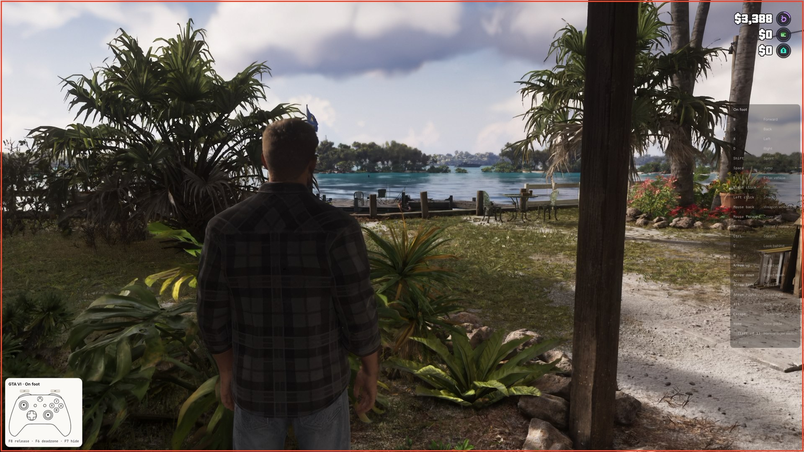
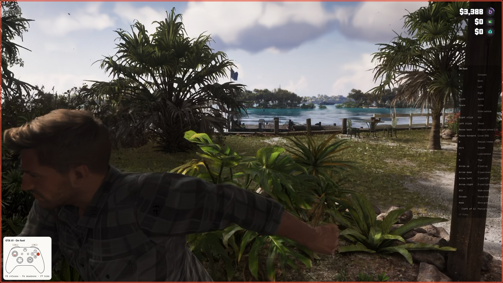
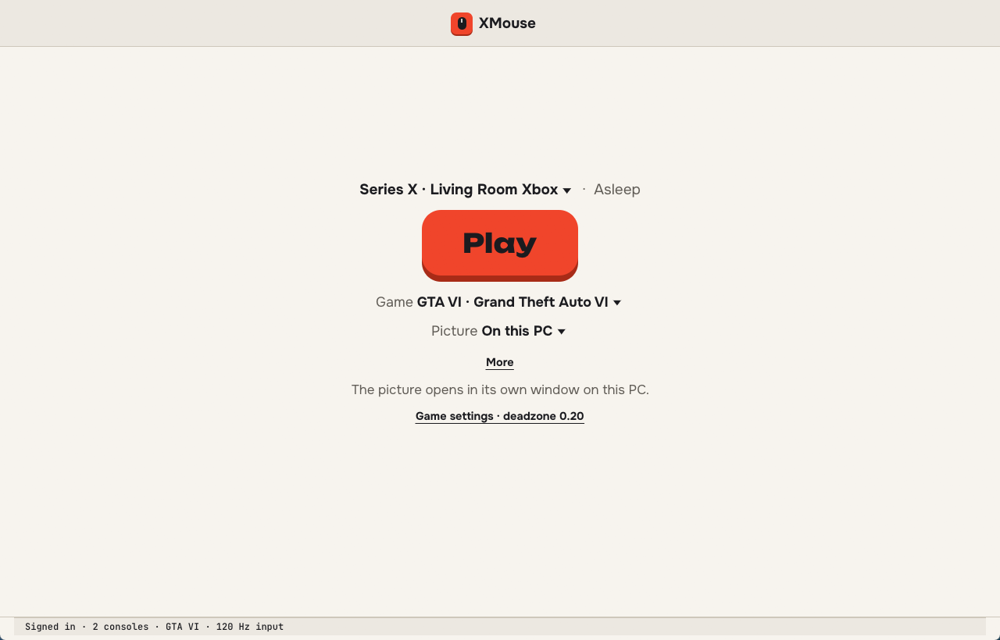
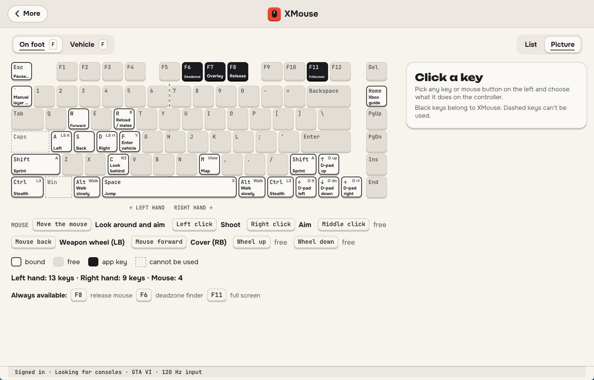
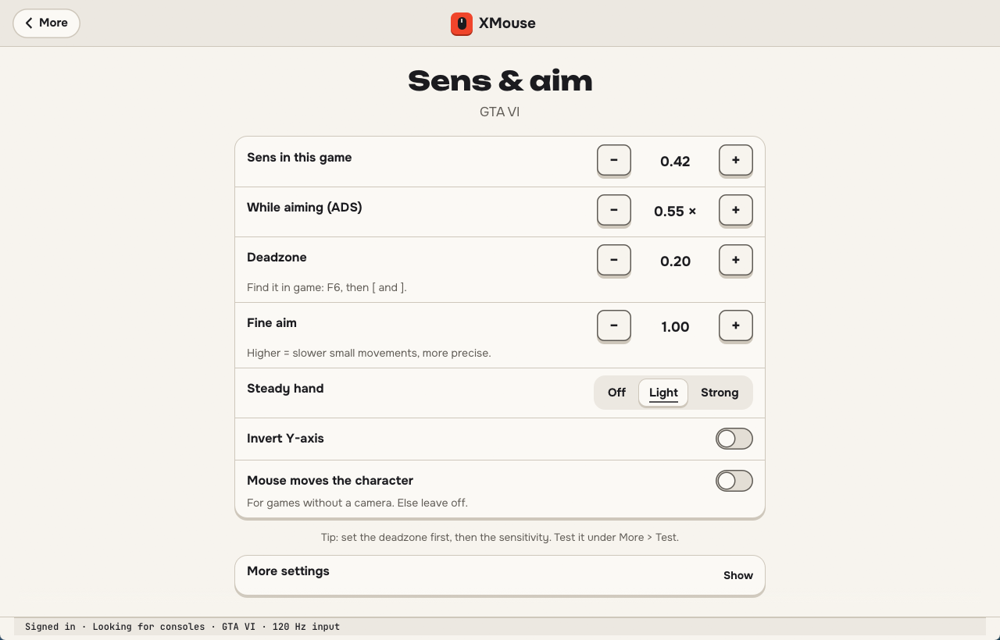
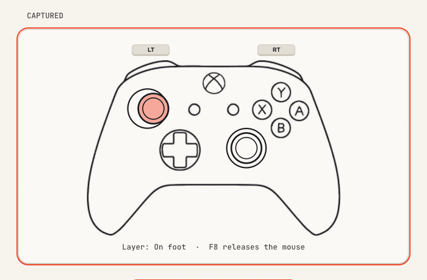

<div align="center">

# XMouse

**Play your own Xbox with a mouse and keyboard, from your PC.**

One small Windows app. Sign in, press Play, and your console's picture and sound open in a window on your PC while your mouse and keyboard drive a virtual controller.



</div>

## What it does

- **Your console, on your PC.** The game streams over your home network in up to 1080p at 60 fps, with sound, in its own window. Go fullscreen with F11.
- **Mouse and keyboard as a controller.** Every key and mouse button can be any controller button, stick direction or trigger. Mouse movement becomes a smooth, tunable right stick.
- **Sharper picture on NVIDIA RTX.** RTX Video Super Resolution upscales the stream to your monitor, so 1080p looks crisp on a 1440p or 4K screen.
- **Ready-made game profiles.** GTA VI, GTA V, Red Dead Redemption 2, a standard shooter layout, third-person action games and the Xbox menus. Each one is fully editable.
- **Layers.** One key can switch the whole layout: in GTA, `F` gets you into a car and your keys turn into driving controls, then `F` again gets you back out.
- **Built to feel tight.** Input goes out at 120 Hz. Video is decoded the moment the last packet of a frame lands, and the app never builds up a backlog.
- **Always know your keys.** A see-through legend at the side of the picture lists what every key does in the current layer, and a live controller in the corner lights up as you press.
- **TV Play too.** Prefer the big screen? Keep the picture on your TV and use XMouse only for the controls.

<div align="center">



</div>

## Getting started

1. **On your Xbox**, open *Settings → Devices & connections → Remote features* and turn on remote features. Under *Xbox app preferences*, allow connections from any device. Setting *Power mode* to *Sleep* lets XMouse wake the console for you.
2. **Download** `XMouse.exe` from [Releases](../../releases) and run it. There's nothing to install.
3. **Sign in** with the Microsoft account that's signed in on your Xbox. XMouse shows a short code and a Microsoft sign-in link; enter the code there.
4. **Pick your console and game**, choose *Picture: On this PC*, and press **Play**.
5. **Click the picture** to hand the mouse and keyboard to the game. **F8** gives them back.

Your PC and Xbox should be on the same home network. A wired connection for either one gives the steadiest picture.

### Series S or Series X?

XMouse works well on an **Xbox Series S** and great on an **Xbox Series X**: the Series X sends a better-quality stream and responds with less input lag.

## Make it yours

<table>
<tr>
<td width="50%"></td>
<td width="50%"></td>
</tr>
<tr>
<td><b>Home.</b> Your console, your game, one big Play button.</td>
<td><b>Keys.</b> Click any key on the keyboard and pick what it does. Hold, tap, toggle and turbo modes, plus layers.</td>
</tr>
<tr>
<td width="50%"></td>
<td width="50%"></td>
</tr>
<tr>
<td><b>Sens &amp; aim.</b> Sensitivity, slower aiming while you hold aim, deadzone, fine aim and smoothing, per game.</td>
<td><b>Test.</b> Try your setup without touching the console. Every press lights up on the controller, and the sticks move with your keys and mouse.</td>
</tr>
</table>

**Find the deadzone in game.** Press **F6** during play. XMouse nudges the right stick a little at a time; use `[` and `]` until the camera just starts to move, then press F6 again to save it. Then set your sensitivity.

## Keys while you play

| Key | What it does |
| --- | --- |
| **F8** | Give the mouse and keyboard back to Windows |
| **F11** | Fullscreen |
| **F7** | Show or hide the controller and the controls legend |
| **F6** | Deadzone finder |

### GTA VI layout

| On foot | | In a vehicle | |
| --- | --- | --- | --- |
| `W A S D` | Move | `W` / `S` | Accelerate / brake |
| Mouse | Look and aim | `A` / `D` | Steer |
| `Shift` | Sprint | `Shift` / `Space` | A / X |
| `Space` | Jump | `H` | Horn |
| `F` | Enter vehicle | `F` | Exit vehicle |
| Right / left click | Aim / shoot | Mouse back / forward | Drive-by aim / handbrake |
| Mouse back / forward | Weapon wheel / cover | `R` | Cinematic camera |
| `R` | Reload / melee | `C` | Look behind |
| `Ctrl` | Stealth | `M` | Map |
| `C` | Look behind | Arrow keys | D-pad (radio, headlights) |
| `M` | Map | | |
| Arrow keys | D-pad | | |
| `Alt` | Walk slowly | | |

## Tips

- **The game ignores your keys but the Xbox menus react?** The game is still listening to the controller that started it. Press `Home` (the Xbox button), select the game's tile and press `Shift` (A) to jump back in with XMouse. Or start the game from XMouse in the first place.
- **No sharper picture on RTX?** Turn on *Super Resolution* under *Graphics → Video* in the NVIDIA app, and check that *RTX Video upscaling* is *On* under *More → Picture and connection* in XMouse.
- **Picture stutters?** Plug the PC or the Xbox into the router with a cable, and close other heavy downloads on the network.

## Build from source

You need [Rust](https://rustup.rs) (MSVC toolchain), the Visual Studio C++ build tools and CMake.

```powershell
cargo build --release
```

The app ends up in `target\release\xmouse.exe`. Run the tests with `cargo test`.

## License

XMouse is licensed under [CC BY-NC-SA 4.0](LICENSE) (Creative Commons Attribution-NonCommercial-ShareAlike 4.0).

- **You can** use it, share it, change it and build on it.
- **You can't** sell it or anything made from it.
- **Anything you make from it** has to give credit and be shared under this same license, so it stays open.

## Not affiliated

XMouse is an independent project for playing your own console at home. It isn't made, endorsed or supported by Microsoft or by any game publisher. Xbox is a trademark of Microsoft. Game names and screenshots belong to their owners.
